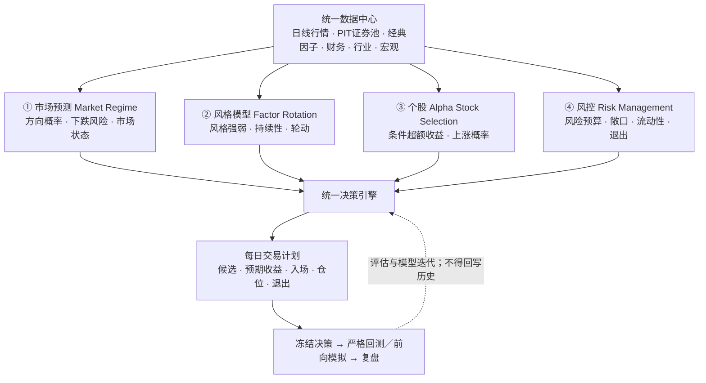

# 美股多层量化决策系统（Multi-Layer Quant Trading System）

> **核心目标**：每天美股收盘后，基于截至决策时点真实可用的市场、风格、个股与风险数据，预测未来 **1 / 3 / 5 个交易日**的机会，输出可追溯的**候选股票、预期收益／上涨概率、入场条件、仓位和退出规则**，并以严格回测与连续前向观察验证其有效性。
>
> **目前开发进度：QDR V4 代码改造进行中。** 已增加自定义因子公式、因子冗余诊断、组合集中度风险预警及四层导航，但尚缺具备历史时点资格的完整个股数据和可验证的连续预测—模拟交易闭环。不支持真实券商下单。具体见 [V4 开发进度与待验收事项](docs/V4_DEVELOPMENT_STATUS.md)。

## V4 最新实现进度（2026-11-11）

新改造已落地可执行的自定义因子表达式、因子相关性/贡献诊断、个股总收益与超额收益分离建模、基于真实模拟账本的集中度预警。**这些改动尚不能证明市场/个股真实预测优势或成本后盈利**。完整范围、未完成的 PIT/回测/模型校准/日终调度依赖，请查看 [V4 开发进度](docs/V4_DEVELOPMENT_STATUS.md)。

原配置中 2025 年以后的封存区间仅作为**对应旧实验的历史研究协议**保留；新滚动研究不应被禁止使用最新合格数据，也不得把已反复查看的历史年份重新宣传为独立未见样本。

## 1. 系统初心与核心原则

系统不是行情看板、技术指标集合或“机会推荐”演示站，而是一个**以可检验的收益预测为核心，以数据、风控和模拟执行为约束的低频量化决策系统**。

用户每个交易日收盘后应能回答：

1. **市场**：未来 1–5 个交易日的大盘方向与显著下跌风险如何？市场处于什么状态？
2. **风格**：小盘、价值、动量、质量、低波动等哪类股票相对占优或正在转强？
3. **个股**：哪些股票的条件预期收益／上涨概率具备样本外证据？主要驱动因素是什么？
4. **风控**：扣除成本后是否值得承担风险？允许的仓位、入场条件与退出条件是什么？
5. **验证**：当日研究是否真正冻结，后续信号、模拟成交、收益与风险能否逐日复核？

**首个可用版本先用简单统计方法把四层贯通；只有在样本外验证证明增量价值后，才升级更复杂模型。**

核心原则：

- **不做“四个模型分别打 100 分再相加”**。市场与风格主要提供条件特征，Alpha 预测条件收益，风控约束可交易性与仓位。避免重复计算相同市场信息。
- **决策与观察分离**。行情观察、探索性因子结果、合格冻结预测、模拟交易具有不同资格，不能互相冒充。
- **真实数据先于漂亮结果**。缺少数据或时点证据，返回明确的 BLOCKED / N/A；不生成虚构收益、胜率、预测概率、成交或持仓。
- **收盘后决策，下一交易日才可成交**。不把收盘后才知道的信息用于当日收盘成交；不后补历史信号。
- **预测需要证明有效**。概率必须经过样本外校准，收益需要与基准及成本比较；不可因为“逻辑听起来合理”而发布交易建议。
- **先可持续运行，后增加复杂度**。重视数据更新、每日研究任务、模型冻结、风险复核及长期前向评估。

## 2. 总体架构与决策流程



**实际建模关系**：先以个股特征 \(X_{i,t}\)、市场条件 \(M_t\)、风格条件 \(F_t\) 预测个股收益：

\[
\widehat{\mu}_{i,t,H}=f(X_{i,t},M_t,F_t),\qquad H\in\{1,3,5\}
\]

这里的 \(f\) 在第一版可以是简单线性回归或逻辑回归，不意味着必须同时训练四个大型 ML 模型。市场状态是否需要进入 Alpha、风格是否提供额外预测力，都要在同一样本外窗口做消融实验验证。

## 3. 四层模型：先建立可复现的最小版本

### ① 市场预测模型 · Market Regime（第一优先级）

解决：**未来 H 日 SPY 上涨概率、显著下跌概率，以及当前趋势／震荡／风险扩张／风险收缩状态。**

| 初始特征（8组） | 具体输入 | 研究意义 |
| --- | --- | --- |
| 市场短期收益 | SPY 过去 5 日收益 | 短期强弱 |
| 市场中期收益 | SPY 过去 20 日收益 | 中期趋势 |
| 市场广度 | PIT 历史股票池中站上 MA20 的比例 | 上涨参与度；无历史股票池时必须标记缺失，ETF 广度不能替代 |
| 波动变化 | SPY 5 日 / 20 日实现波动率 | 风险扩张或收缩 |
| 等权相对强弱 | RSP / SPY 相对收益 | 集中度代理 |
| 信用风险代理 | HYG / LQD 相对变化 | 信用风险偏好代理，并非官方信用利差 |
| 利率冲击 | 美国 10 年期国债收益率变化 | 利率环境 |
| 行业相关性 | 行业 ETF 滚动相关性 | 同涨同跌与市场同步性 |

**第一版算法**：固定状态判别规则 + 逻辑回归；建立 H=1/3/5 的独立标签和预测。以 T 收盘后可获得的 \(X_T\) 预测 **T+1 开盘到 T+H 收盘**的 SPY 回报，而不是 T 当日收盘入场。

\[
P(R^{\mathrm{SPY}}_{T+1\,open\rightarrow T+H\,close}>0\mid X_T)
\]

下跌风险另设目标（例如同一持有窗口收益低于 -2%），不能拿“上涨概率的补数”充当下跌尾部概率。

| 输出字段 | 含义 |
| --- | --- |
| market_up_prob_{H}d | H 日市场上涨的校准预测概率 |
| market_downside_prob_{H}d | H 日显著下跌的校准预测概率 |
| market_regime | 客观定义的市场状态 |
| market_confidence / uncertainty | 样本外可靠性或不确定性；无证据则为 null |

模型分数不等于真实胜率。必须报告样本外 Brier / LogLoss、校准曲线、常数基准及不同环境下的误差。缺失数据时不输出看似精确的概率。

### ② 经典因子模型 · Factor Rotation

目标：识别**市场当前偏好的风格、转强／转弱与持续性**。第一版先做描述性状态，再验证是否对未来收益有预测增量。

历史研究可使用 [Kenneth French Data Library](https://mba.tuck.dartmouth.edu/pages/faculty/Ken.French/data_library.html) 的日频因子数据；日常可辅以真实 ETF 相对收益观察，但**ETF 代理不等于纯 Fama–French 因子收益**。

| 风格 | 历史研究数据 | 日常观察代理 |
| --- | --- | --- |
| 小盘相对大盘 | SMB | IWM 相对 SPY |
| 价值相对成长 | HML | IWD 相对 IWF |
| 动量 | MOM | MTUM 相对 SPY |
| 质量 | RMW 等 | QUAL 相对 SPY |
| 低波动 | 自建低波动因子 | USMV 相对 SPY |
| 高 Beta | 自建高低 Beta 组合 | 高 Beta 组相对低 Beta 组 |

每种风格首先计算：

| 特征 | 初始算法 |
| --- | --- |
| 风格动量 | 最近 5 / 20 日相对收益 |
| 风格变化率 | 最近 5 日相对收益减去此前 5 日 |
| 风格持续性 | 最近 10 日正相对收益天数比例 |
| 风格波动率 | 最近 20 日相对收益标准差 |

输出客观定义的“强势延续、转强、转弱、弱势延续”等状态及原始数值、来源与截至日。状态阈值只能在训练窗口确定。只有当风格变量在相同样本外比较中改善 Alpha 预测，才赋予其正式决策权重；否则保留为观察信息。

### ③ 个股 Alpha 模型 · Stock Selection（核心收益预测层）

第一阶段重点验证**超跌反弹与下跌衰竭**，而不是先堆大量无独立增量的指标。

| 初始个股特征 | 计算方式 |
| --- | --- |
| 5 日反转 | 过去 5 日收益率取负 |
| 行业残差反转 | 个股 5 日收益减去行业风险调整收益，再取负 |
| 中期动量 | 12-1 月动量，避开最近 1 个月 |
| 波动变化 | 5 日 / 20 日实现波动率 |
| 成交异常 | 当日成交金额 / 历史 20 日平均成交金额 |
| 收盘位置 | (收盘价−最低价) / (最高价−最低价)，零振幅需特殊处理 |
| 行业强弱 | 行业相对 SPY 的过去 5 日收益 |
| 市场敏感度 | 滚动 Beta 与特质波动率 |

**两个独立预测目标：**

1. H 日个股相对基准／行业的超额收益（回归）。
2. H 日实际交易窗口收益大于 0 的概率（分类）。

第一版采用线性／Ridge 回归与逻辑回归，后续在冻结的对照协议下尝试 LightGBM。行业、基本面、证券身份缺少 PIT 数据时，不得以当前行业或当前存活股票池倒灌历史；可以先运行明确标注“探索性”的 ETF 或合格子集研究，但不能称为真实个股 Alpha 验证完成。

市场与风格是 **Alpha 的条件特征**，不是额外加分项。应对比：

- A：个股 Alpha 特征；
- B：A + 市场条件；
- C：A + 风格条件；
- D：A + 市场 + 风格 + 预先定义的交互；

同样本、同标签、同训练窗口、同成本口径下比较样本外贡献。必须同时检查市场与风格重复解释、共线性、滚动稳定性和过拟合。

### ④ 风控模型 · Risk Management

第一版使用**确定性风险规则**，先保证交易可执行、仓位合理、退出可核验；不需要立即训练复杂风险模型。

| 风控项 | 初始研究参数（非验证最优值） |
| --- | --- |
| 单股最大仓位 | 权益 10% |
| 单笔计划风险预算 | 权益 0.3% |
| 初始止损距离 | 2 × ATR(20) |
| 组合总仓位 | 不超过 50% |
| 单行业仓位 | 不超过 25% |
| 流动性门槛 | ADV20 ≥ 2,000 万美元 |
| 默认持仓期 | H=3，另评估 H=1 / 5；先触发风控则提前退出 |
| 重大财报过滤 | 排除入场前已知、落在预计持仓期内的重大财报事件 |

单股计划仓位上限按下式计算（止损距离采用价格百分比）：

\[
w_i\leq\min\left(10\%,\frac{0.3\%}{\text{stop\_distance\_pct}_i}\right)
\]

例如 ATR 为股价 2%，2×ATR 止损距离约 4%，对应的计划风险仓位上限为 7.5%；**不代表隔夜跳空时最大亏损必然锁定在 0.3%**。还必须考虑组合相关性、行业集中、尾部风险、滑点、流动性与无法按止损价成交的情况。风险扩张时可按预先冻结的规则降低总暴露或暂停新增入场，但不得凭叙事事后改参数。

## 4. 决策引擎与每日交易清单

**决策不是多模型投票，而是条件预测 + 成本净优势 + 组合风险约束。**

\[
\text{NetEdge}_{i,t,H} =
\widehat{R}^{\mathrm{trade,gross}}_{i,t,H} -
\widehat{\text{Cost}}_{i,t,H}
\]

注意：如果 Alpha 模型输出的是**相对基准超额收益**，必须先按一致的市场／行业假设还原或另行预测可交易的**总收益**，不能直接把超额收益减成本当作绝对交易优势。成本至少包含手续费、双边滑点和交易冲击；只有具有可信估计且达到冻结的风险收益门槛时，才进入模拟计划。

| 步骤 | 决策行为 |
| --- | --- |
| 1. 市场条件 | 识别市场风险状态，执行预先定义的暴露约束 |
| 2. 风格条件 | 记录占优／转强风格；仅在增量验证通过后影响 Alpha |
| 3. 个股预测 | 计算未来 H 日条件收益、上涨概率及不确定性 |
| 4. 净优势筛选 | 估算成本，排除无可靠优势或事件／流动性不合格的标的 |
| 5. 风控定仓 | 执行单笔风险预算、组合上限、行业上限及相关性检查 |
| 6. 冻结与前向记录 | T 日冻结计划，T+1 才允许按实际可得价格模拟入场，并按冻结退出规则续记 |

**每日交易清单的数据契约**（没有合格值时留空，绝不虚构）：

| 字段 | 含义 |
| --- | --- |
| session_date_et / frozen_at_utc | 信号交易日与冻结时间 |
| security_id / symbol | 永久证券身份与当时代码 |
| horizon / planned_exit | 持有期及计划退出交易日 |
| expected_trade_return / expected_excess_return | 区分总收益与超额收益的预测 |
| probability_up / downside_estimate | 校准后上涨概率与风险估计 |
| entry_condition | T+1 可执行的具体入场触发条件 |
| planned_weight / shares_estimate | 按风险预算确定的计划仓位／数量 |
| stop_rule / exit_rule | 初始止损、风险事件与到期退出规则 |
| estimated_cost / net_edge | 预估交易成本和净优势 |
| eligibility / missing_evidence | 观察、探索、合格候选或 BLOCKED 资格 |
| model_version / data_snapshot_sha256 | 冻结模型版本及真实数据快照证据 |

**交易清单不等于真实订单。** 当前系统只允许研究与合规证据齐全的模拟记录，真实券商下单始终关闭。任何空候选日都应被正常记录，不能强制每天产生交易。

## 5. 统一数据中心与时点约束

核心数据层至少包含以下逻辑表（名称为目标数据契约；实际落库可拆分为多表，**不代表当前已全部实现**）：

| 逻辑表 | 主要内容 | 用途 |
| --- | --- | --- |
| prices_daily | 股票／ETF OHLCV、价格口径、成交额、来源 | 行情与交易特征 |
| universe_daily | 历史有效股票池、上市／退市／代码变动及身份 | 抑制幸存者偏差 |
| fundamentals_pit | 基本面、披露时间、可用时间与版本 | 财务／规模因子 |
| factor_returns | 经典因子收益、版本、实际可用时间 | 风格历史研究 |
| features_daily | 冻结的市场／风格／个股特征 | 训练与每日推理 |
| predictions_daily | 模型、目标、预测值、置信状态、冻结时间 | 决策证据 |
| trades | 冻结信号、委托计划、模拟成交、费用、退出、现金流 | 严格回测／前向模拟 |

配套还需要独立管理：**company_actions（公司行为）、industry_history（历史行业映射）、macro_series（宏观数据）、model_registry（模型版本）、source_receipts（原始回执）、paper_ledger（模拟账本）**。

数据必须严格区分：

- **event_time**：行情／事件实际发生时间；
- **available_at**：当时可用于决策的真实发布时间或最早可用时间；
- **ingested_at**：系统首次实际获取时间；
- **effective_date / session_date**：证券身份、公司行为或交易日适用日期；
- **source + adjustment_basis + snapshot_sha256**：来源、复权口径与快照校验。

单靠“数据是真实的”不能证明其历史可用性；不得用今天的股票池、当前行业、最新财报或追溯调整的数据版本冒充过去当时可知道的信息。Yahoo 当前版本历史回溯可做探索，但不得作为严格原价成交、PIT 历史模型或模拟现金结算依据。

**数据时效目标**：每天收盘后核验最近应当完成的美股交易日、来源权限、完整性、延迟、缺口与哈希。未取得最新合格数据时明确标示“截至哪天”，不能把历史数据包装为“实时”。低频决策首先要求可靠日终数据，盘中观察在真实权限与时间延迟核实后再扩展。

## 6. 统一研究、回测与前向验证协议

- **预测窗口**：H=1、3、5 个 XNYS 交易日；T 收盘后生成并冻结信号，T+1 原始开盘价入场、T+H 收盘按策略退出，或预先定义的风险事件提前退出。
- **目标一致性**：方向概率、超额收益、总交易收益、下跌风险分别建模和评估，不混用定义；市场与个股使用一致的交易窗口。
- **时间切分**：滚动或扩展训练窗口，按标签真实退出时间 purge，至少 5 个 session gap；所有标准化、缺失填补、阈值、模型选择只在训练期拟合。
- **当前项目封存协议**：2017–2022 训练、2023–2024 验证；2025-01-01 起为封存最终测试期。未经明确授权与独立验收，不得将封存期结果用于择模、调参或展示“最终验证通过”。
- **预测评价**：市场／个股方向使用 Brier、LogLoss、校准分箱及常数基准；收益预测评估 OOS IC、回归误差、分组差异与滚动稳定性；策略评估成本后收益、回撤、换手、容量、资金利用率、尾部损失与市场分段表现。
- **增量验证**：对比 Alpha 单层和加入市场／风格后的相同日期、相同证券池样本外结果；分层子样本 IC 不等于交易盈利增量。多次实验需控制择优偏差。
- **模拟真实约束**：公司行为、停牌、退市、分红、隔夜跳空、滑点、费用、持仓限制和账本对账不得忽略或虚构。重复交易日运行幂等，错误时失败关闭，不自动补造历史交易。

**研究输出至少说明：数据版本、预测目标、训练／验证窗口、样本数、基准、统计不确定性、交易成本假设、可用性限制及与上一版本的差异。** 没有经验证的优势，系统应诚实输出“暂无满足条件的交易”。

## 7. 产品体验：让用户每天完成真实的预测与决策

用户的主路径应是：

**收盘更新 → 数据健康核验 → 市场预测 → 风格判断 → 个股 Alpha 候选 → 风控定仓 → 冻结交易清单 → 前向复盘。**

首页优先回答“今天研究完了吗、市场环境如何、有哪些合格候选、能否承担风险、为什么没有交易”，而不是堆导航卡片、开发进度、UUID 和技术术语。

- **每日决策工作台**：最新完整交易日、数据状态、市场预测／风险、风格摘要、候选与异常、策略版本及任务状态。
- **四层研究入口**：市场预测、风格监测、个股 Alpha、风控参数与诊断；可从结果进入证据与实验记录。
- **每日交易清单**：区分“观察候选”“已验证预测候选”“满足模拟准入”三层；显示入场、仓位和退出，不用漂亮的空壳表格代替能力。
- **回测与前向模拟**：读取真实证据合格的绩效，明确成本与口径；可用时展示完整资金曲线和逐日交易，不符合资格时只展示具体缺项。
- **高级数据管理**：来源回执、哈希、时点审计与 G 阶段技术细节折叠在高级区域，不挤占日常决策界面。

产品设计服务于**预测 → 决策 → 验证**，不应将系统改造成脱离核心模型的泛用市场观察平台。

## 8. 开发路线与优先验收

| 阶段 | 交付重点 | 退出标准 |
| --- | --- | --- |
| P0 · 数据与运行底座 | 稳定日终数据更新、来源时点／质量校验、完整会话、统一研究契约 | 数据可用时可以自动完成最新交易日维护；数据不可用时可定位原因、不伪造结果 |
| P1 · 市场 + 风格 | 市场 H1/H3/H5 基线、下跌风险、校准验证；French／ETF 风格观察 | 可重现 OOS 市场结果、基准对比、风格状态及缺失证据 |
| P2 · 个股 Alpha | PIT 证券池与价格／行业特征、反转因子、条件收益与方向预测、四层消融 | 个股预测与市场／风格增量有独立样本外证据，无泄漏 |
| P3 · 风控与每日决策 | 风险预算、成本、交易计划、冻结决策、严格回测、连续模拟账本 | 每日能生成真实合格或空候选清单，并可跨日追踪与对账 |
| P4 · 增强与实用化 | 更好模型、风格条件、预警、可视化与长周期可靠性 | 相比冻结基线确有稳定增量，不以功能数量作为完成标准 |

**实施优先级：先完成可信的日频预测闭环，再开发实时能力、复杂 ML、自动化交易和装饰性大屏。** 每阶段同时交付可操作的界面、真实证据和可复现的验收，而不是只提交函数与功能入口。

## 9. 当前仓库实际能力与限制（截至 2026-11-11）

以下是**代码与阶段文档的能力边界**，并非完整本机真实数据端到端验收结果：

| 模块 | 已有实现 | 关键未完成项 |
| --- | --- | --- |
| 数据中心 | Yahoo 探索、Alpaca／SEC／French 接入与审计、部分真实来源采集及日常维护 | 数据权限与新鲜度实测、完整 PIT 证券身份／行业、公司行为权益与结算证据 |
| 市场 | SPY H1/H3/H5 历史回溯研究、状态和下跌风险研究骨架 | 真实 PIT 资格、可持续 OOS 校准及每日合格预测 |
| 风格 | French 因子观察、ETF 风格代理、因子研究 | 领先性与对 Alpha 的样本外增量验证 |
| 个股 Alpha | 因子实验、组合排名、部分历史 ETF 研究 | 完整个股 PIT 训练集与严格可交易 Alpha 预测 |
| 风控与回测 | 仓位限制、模拟引擎、策略冻结、严格资格检查与历史结果读取器 | 有真实资格的完整 P5 回测、全链成本与公司行为验收 |
| 每日决策与模拟 | 日终观察、冻结候选只读校验、模拟账本及逐日对账审计 | 自动合格候选生成、连续前向模型／交易闭环与本机真实验证 |

当前正式 UI/API/报告执行 **REAL_ONLY**：缺来源、哈希、时点或身份即返回明确 BLOCKED；旧生成器与旧市场测试已隔离在 archive/pre_real_only，不作为正式验收。2025 起最终测试区间仍封存；**不支持真实券商订单、不自动开户／采购／解封测试**。

## 10. 本地运行与技术文档

要求 Python 3.11–3.13；在项目根目录运行（Windows PowerShell）：

```powershell
uv sync --locked
.\scripts\start_console.ps1 --port 8766
# 浏览器访问 http://127.0.0.1:8766

# 日常数据维护：需要本地合法来源权限与 .env 配置
.\scripts\run_daily.ps1

# 查阅真实数据资格和研究进度
.\.venv\Scripts\python.exe -m quant_research.cli research-readiness
.\.venv\Scripts\python.exe -m quant_research.cli data-catalog
.\.venv\Scripts\python.exe -m quant_research.cli frozen-candidates
.\.venv\Scripts\python.exe -m quant_research.cli paper-timeline

# 测试：通过单元测试不代表真实数据／交易资格已通过
uv run --locked pytest -q
```

- [REAL_ONLY 数据与防伪造政策](docs/REAL_DATA_POLICY.md)
- [统一架构与使用说明](docs/system_guide.md)
- [日常数据维护](docs/DAILY_DATA_MAINTENANCE.md)
- [因子实验室](docs/FACTOR_LAB_GUIDE.md)
- [严格冻结预测／就绪矩阵 G12](docs/G12_readiness_and_prediction_audit.md)
- [前向候选来源验收 G13](docs/G13_frozen_candidates.md)
- [模拟账本逐日审计 G14](docs/G14_paper_timeline.md)
- [现行 Codex 工程约束](AGENTS.md)

API 密钥仅在本地环境配置，不提交仓库、不写入日志或对话。README 定义目标与使用边界；任何新能力必须先由对应真实数据、代码实现和验收记录证明，才能在“当前能力”中标记为已完成。

---

**项目成功的标准不是页面数量、指标数量或模型复杂度，而是：每天都能基于当时真实可用的数据，给出可追溯、风险受控、能够在未来独立验证的 1–5 日量化决策；当证据不足时，明确选择不交易。**
